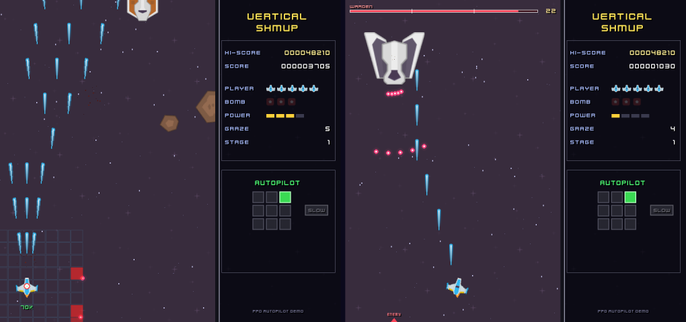

# Vertical Shmup

縱向彈幕射擊遊戲，附帶一個用 **DQN（Deep Q-Network）** 訓練的自動駕駛 agent，
會自己閃避敵人和子彈、撿道具、打魔王。有 **pygame 版**，也有免安裝的**網頁版**可以直接拿來 demo。

> 所有素材、演算法、函式庫都是 **2019 年以前**就已經存在的，檢查結果在下方「2019 年以前檢查」。



---

## 目錄

1. [快速開始](#快速開始)
2. [遊戲設計](#遊戲設計)
3. [從訓練到結果的流程](#從訓練到結果的流程)
4. [自動駕駛（DQN）](#自動駕駛dqn)
5. [訓練](#訓練)
6. [訓練時間估計](#訓練時間估計)
7. [網頁版（demo 用）](#網頁版demo-用)
8. [專案結構](#專案結構)
9. [測試](#測試)
10. [2019 年以前檢查](#2019-年以前檢查)

---

## 快速開始

```bash
pip install -e ".[game]"       # 玩遊戲：numpy + pygame
pip install -e ".[game,rl]"    # 再加上 PyTorch：自動駕駛 / 訓練
```

```bash
python -m shmup                 # 自己玩
python -m shmup --autopilot     # 看 DQN 自己玩（要先訓練好模型）
```

**訓練完全不需要畫面**：`core/`（遊戲規則）和 `agent/`（強化學習）都不會 import pygame，
只有自己玩或 demo 的時候才會開視窗。

| 按鍵 | 功能 |
|------|------|
| 方向鍵 / WASD | 移動 |
| Shift | 慢速精準移動（會顯示判定點） |
| X | 炸彈 |
| Tab | 自動駕駛 開 / 關 |
| V | Agent 視角（顯示網路看到的危險格） |
| P / M / Esc | 暫停 / 靜音 / 離開 |

---

## 遊戲設計

參考彈幕射擊遊戲這個類型的經典玩法，全部自己重新實作。

**敵人會開火**：瞄準玩家的「自機狙」、扇形彈、環形彈、旋轉螺旋彈、雷射。

| 敵人 | 行為 |
|------|------|
| Scout | 直直往下飛，發射自機狙 |
| Weaver | 蛇行，發射三向扇形彈 |
| Diver | 停住瞄準一下，然後衝撞玩家 |
| Gunship | 停在畫面上方發射環形彈和雷射，一段時間後離開 |
| 隕石 | 大的打碎會分裂成兩個中的，中的再分裂成小的 |

**道具**：火力升級（最多 4 級）、回血、護盾（擋一次攻擊）、炸彈、加分星星。

**彈幕遊戲的經典機制**：

- 判定點只有 5 px，子彈從身邊擦過（擦彈）會加分
- 炸彈會清掉全畫面子彈；被打中時如果還有炸彈，會**自動放炸彈**抵銷
- 被打之後有一段無敵時間，火力會降一級
- 飛到畫面上方的「收點線」，所有道具會自動吸過來

### 魔王關卡

遊戲一共 3 關，每一關都是「雜魚波次（約 60 秒）→ WARNING → 魔王」。
前兩關各一隻魔王，**最後一關是兩隻魔王同時出場**：

```
第 1 關：雜魚 → WARDEN（1 隻）
第 2 關：雜魚 → HIVE CARRIER（1 隻）
第 3 關：雜魚 → TWIN FANG（2 隻，一左一右）→ ALL CLEAR
```

| 關卡 | 魔王 | 第 1 階段 | 第 2 階段 | 第 3 階段 |
|------|------|-----------|-----------|-----------|
| 1 | WARDEN | Aimed Fans：五向自機狙 + 慢速大彈環 | Twin Spiral：雙螺旋 + 雷射 | Last Stand：密集環形彈 + 高速自機狙 |
| 2 | HIVE CARRIER | Drone Bay：放出無人機 + 環形彈 | Bloom：五瓣花形彈，每 2 秒反轉方向 | Laser Rain：雷射從上方隨機落下 |
| 3（最後一關） | TWIN FANG x2 | Crossfire：雙砲口交叉雷射 | Pinwheel：反向旋轉的風車彈 | Fang Rush：兩隻一左一右夾擊玩家 |

- 每隻魔王 HP 剩 66%、33% 時換階段，畫面上的子彈會被清掉，並顯示階段名稱
- 每個階段有 30 秒時限：時間內打破有 +1000 分；時間到直接換下一階段；最後階段時間到魔王會逃走
- 最後一關的兩隻 TWIN FANG 各自有血條和階段；**先打倒一隻，另一隻會暴走（RAGE），射速變兩倍**
- 兩隻都打倒就 **ALL CLEAR**，加 20,000 分 + 每剩 1 滴血 5,000 分，遊戲結束

### 畫面風格

參考縱向彈幕射擊遊戲常見的版面（這個類型的共同慣例，不是照抄某一款遊戲）：

- **右邊資訊面板**：遊戲區在左邊，右邊是有外框的面板，顯示 HI-SCORE、SCORE、PLAYER（剩幾條命）、
  BOMB、POWER、GRAZE、STAGE；自動駕駛時還會顯示 3x3 搖桿燈號，看 AI 選了哪個方向、有沒有開慢速
- **魔王血條在上方**：每隻魔王一條，有階段刻度、魔王名稱和階段倒數秒數；雙魔王時會有兩條
- **ENEMY 標記**：遊戲區最下面有紅色三角形，標出魔王現在的左右位置
- **關卡標題帶**：STAGE、WARNING、ALL CLEAR 會用橫跨整個遊戲區的色帶顯示


---

## 從訓練到結果的流程

```
[1] 遊戲規則  src/shmup/core/
     │   純 Python 模擬，不用畫面，同一個 seed 一定跑出同一局
     │   每秒約 5,000–11,000 次決策（本機實測）
     ▼
[2] 環境 + 觀測  src/shmup/agent/env.py、features.py
     │   每 2 個 frame 做一次決策（每秒 30 次）
     │   觀測：284 個數字（自機、最近 24 顆子彈、最近 8 個敵人、9x9 危險格、道具、魔王）
     │   動作：18 種（9 個方向 x 一般 / 慢速）
     │   獎勵：活著 +0.01、掉血 -1、吃道具 +0.05 …
     ▼
[3] 訓練  scripts/train_cpu.py（本機）或 scripts/train_gpu.py（Colab）
     │   ┌─▶ 同時玩 8 局（CPU）/ 64 局（GPU）
     │   │     ▼
     │   │   ε-greedy 選動作（ε 從 1.0 慢慢降到 0.02）
     │   │     ▼
     │   │   整理成 3-step transition，存進 replay buffer（30 萬 / 100 萬筆）
     │   │     ▼
     │   │   隨機抽一個 batch，算 Double DQN 目標、Huber loss
     │   │     ▼
     │   │   更新 Dueling 網路；每 2,000 次更新同步一次 target 網路
     │   └─────┘
     ▼   每 15 萬步（GPU 版每 40 萬步）
[4] 評估  用固定的 10 個 seed、ε = 0 各玩一局
     │   ├─▶ 存活最久的模型      → models/dqn.pt
     │   └─▶ 最新模型 + optimizer → models/dqn_last.pt（斷線時用 --resume 接著訓練）
     ▼
[5] 匯出  scripts/export_web.py
     │   models/dqn.pt → web/model/dqn_model.js（權重轉成 base64）
     ▼
[6] 看結果（這一步才需要畫面）
     ├─▶ pygame 版：python -m shmup --autopilot
     ├─▶ 網頁版：  web/index.html（純 JavaScript 推論，可以開 Agent 視角、直接打魔王）
     └─▶ 錄影：    scripts/record_video.py（第 10 / 50 / 500 / 2000 回合的權重各錄一支，同一個 seed）
```

---

## 自動駕駛（DQN）

只使用 2019 年以前發表的方法：

| 方法 | 出處 | 用途 |
|------|------|------|
| DQN、經驗回放（experience replay）、目標網路（target network） | Mnih et al., Nature 2015 | 讓神經網路版的 Q-learning 穩定 |
| Double DQN | van Hasselt et al., AAAI 2016 | 修正 Q 值高估 |
| Dueling Network | Wang et al., ICML 2016 | 分開學「局面好壞」和「動作差異」 |
| n-step return（n = 3） | Sutton 1988；Rainbow 2017 | 讓獎勵往回傳得更快 |
| Adam、Huber loss、ε-greedy、梯度裁剪 | 2014 年以前 | 優化與穩定 |

- **觀測（284 維）**：不是看畫面像素，而是整理好的數字，所以小的 MLP 就學得動，瀏覽器也跑得動。
- **動作（18 種）**：9 個方向 x {一般速度, 慢速}。射擊一直是自動的，agent 只負責移動。
- **獎勵**：每步存活 +0.01、掉 1 滴血 -1、被迫自動放炸彈 -0.5、護盾破掉 -0.3、
  撿道具 +0.05、分數 x 0.0002、死亡 -1。
- **網路**：284 → 256 → 256 → Dueling 輸出頭（V 和 A），CPU 版約 20.7 萬個參數，GPU 版（512）約 67.6 萬個。

詳細的原理和設計理由寫在 `README2.md`（個人筆記，沒有放進 git）。

---

## 訓練

```bash
python scripts/train_cpu.py                       # CPU：同時 8 局、256 單元、300 萬步
python scripts/train_cpu.py --total-steps 500000  # 快速試跑
python scripts/train_gpu.py                       # GPU（CUDA）：同時 64 局、512 單元、800 萬步
python scripts/train_cpu.py --resume models/dqn_last.pt   # 接著上次訓練
python scripts/train_cpu.py --eval-only           # 評估 models/dqn.pt
python scripts/train_cpu.py --help                # 所有超參數都能用參數調整
```

- 存活最久的模型存到 `models/dqn.pt`，最新的（含 optimizer）存到 `models/dqn_last.pt`，按 Ctrl+C 中斷也會存。
- GPU 版只用 PyTorch 1.0 時代就有的 CUDA 功能。**Mac 沒有 CUDA，請用 CPU 版或 Colab。**

### 用全部 CPU 核心訓練 2000 回合，並在第 10 / 50 / 500 / 2000 回合存權重

```bash
python scripts/train_cpu.py --workers 8 --num-envs 16 --threads 2 \
    --max-episodes 2000 --save-episodes 10,50,500,2000 --total-steps 100000000
```

- `--workers 8`：開 8 個程序跑遊戲，一個核心一個（改成你電腦的核心數）
- `--threads 2`：梯度更新用 2 個執行緒；這個網路很小，實測 2 個比 4、8 個都快
- `--max-episodes 2000`：玩滿 2000 回合就停
- `--save-episodes`：在這幾個回合各存一份權重到 `models/checkpoints/dqn_ep{N}.pt`，順便評估 5 局
- log 會印出目前第幾回合（`ep`）

### 錄影：比較不同訓練程度的 agent

```bash
python scripts/record_video.py                       # 錄第 10 / 50 / 500 / 2000 回合的權重
python scripts/record_video.py --episodes 50 2000 --seconds 60
```

每個權重都用同一個 seed 玩一局，畫面跟 pygame 版一樣（含右邊面板和 AI 搖桿燈號），
輸出到 `videos/episode_0010.mp4` 等，另外合成一支 2x2 對照影片 `videos/compare_2x2.mp4`。
不用開視窗；需要電腦裡有 ffmpeg。

### 在 Google Colab 上訓練

1. 在本機打包程式碼，把 zip 上傳到 Google Drive 根目錄：

   ```bash
   git archive --format=zip --prefix=vertical-shmup/ -o ~/Desktop/vertical-shmup.zip HEAD
   ```

2. 到 Colab 上傳 `notebooks/train_on_colab.ipynb`，**執行階段 → 變更執行階段類型 → T4 GPU**，依序執行每個 cell。
   Colab 已經內建 numpy 和 PyTorch，不需要另外安裝。
3. 存檔和 log 會寫到 `MyDrive/shmup/`，斷線後用 `--resume` 接著訓練。
4. 下載 `dqn.pt` 放到 `models/`，`dqn_model.js` 放到 `web/model/`，回到本機 demo。

---

## 訓練時間估計

「訓練 N 回合」指 N 個 episode（一局遊戲，從開始到死亡、ALL CLEAR，或滿 15,000 步約 8 分鐘）。
一開始 agent 幾乎是亂動，一局大約 1,000 步；學會閃避之後一局會越來越長。

| 訓練回合數 | 約等於幾步決策 | 這時候的 agent | CPU 版（本機 Mac 8 核，實測推算） | GPU 版（Colab T4，估計） |
|-----------:|---------------|----------------|---------------------------------:|-------------------------:|
| 10 | 約 1 萬步 | ε ≈ 1，還在收集資料，還沒開始學 | 約 2 秒 | 約 10 秒 ※ |
| 50 | 約 5 萬步 | 剛開始學，ε ≈ 0.97，幾乎還是亂動 | 約 35 秒 | 約 15 秒 ※ |
| 200 | 約 22 萬步 | 大部分還在探索，ε ≈ 0.8 | 約 4 分鐘 | 約 1.5–2 分鐘 |
| 2000 | 約 400–800 萬步 | ε 已降到 0.02，開始會躲彈幕、打到魔王 | 約 1.3–2.5 小時 | 約 35–90 分鐘 |

估計方式與假設：

- **本機實測**（Apple Silicon Mac，8 核）：遊戲模擬每秒約 11,000 步（前期）到 4,900 步（彈幕多的魔王戰）；
  CPU 版一次梯度更新（batch 128）約 3.3 ms，每 4 步做一次，所以**學習階段大約每秒 1,000 步**，
  前 2 萬步只收集資料時大約每秒 8,000 步。
- **Colab 是估計值**：Colab 免費版只有 2 個 CPU 核心，模擬比本機慢；T4 做梯度更新很快，
  但瓶頸還是 Python 的遊戲模擬，大約每秒 1,500–2,500 步。實際速度請看 log 裡的 `steps/s`。
- 時間有包含定期評估（每次評估玩 10 局，agent 越強評估越久）。
- ※ GPU 版一開始就同時跑 64 局，每局約 1,000 步，所以要先跑大約 5 萬步，前 64 個回合才會幾乎同時結束。
- 2000 回合的範圍很大，因為回合長度取決於 agent 學得多好；如果 agent 已經很強、每局都打到最後一關，
  2000 回合最多可能到 2,000 萬步以上（CPU 約 5 小時以上，GPU 約 2–3 小時）。
- 想要能躲過魔王彈幕的 agent，建議至少訓練 300 萬步（CPU 約 50–60 分鐘、Colab 約 20–35 分鐘）。

---

## 網頁版（demo 用）

```bash
python scripts/export_web.py        # 把 models/dqn.pt 轉成 web/model/dqn_model.js
python -m http.server 8000          # 在專案根目錄開一個本機伺服器
```

打開 <http://localhost:8000/web/>（也可以直接用瀏覽器開 `web/index.html`，但字型和音效可能載入不完整）。

頁面做成街機機台的樣子，右邊的操作台可以：

- 「自己玩」/「AI 開車」切換
- 「直接打魔王」/「下一關魔王」，demo 時不用等雜魚
- x1 / x2 / x4 速度、「危險格」（看網路眼中的危險區域和它選的方向）、音效開關
- 「AI 現在想往哪走」：3x3 搖桿會亮出 AI 選的方向，慢速時 SLOW 燈會亮，旁邊是那個動作的 Q 值
- 顯示 AI 跑了幾局、平均幾分

網頁版的神經網路是用純 JavaScript 做矩陣乘法，不需要任何機器學習函式庫。
Safari 不支援 `.ogg` 音效，建議用 Chrome 或 Firefox。

---

## 專案結構

```
vertical-shmup/
├── setup.py / requirements.txt   安裝設定與相依套件
├── README.md / CREDITS.md        說明文件、素材來源
├── assets/                       所有素材（pygame 版和網頁版共用）
│   ├── images/                   player、enemies、projectiles、items、effects、backgrounds、ui
│   ├── sounds/                   sfx（音效）、music（背景音樂）
│   ├── fonts/
│   └── licenses/                 素材的原始授權檔
├── src/shmup/                    Python 套件
│   ├── __main__.py               `python -m shmup` 的進入點
│   ├── paths.py                  所有檔案路徑
│   ├── core/                     遊戲規則（不用 pygame）
│   │   ├── rules.py              所有可調整的數字（網頁版的 rules.js 由它產生）
│   │   ├── rng.py                可重現的亂數（xorshift32）
│   │   ├── entities.py           玩家、子彈、道具
│   │   ├── enemies.py            敵人和魔王的行為
│   │   ├── patterns.py           彈幕的發射方式
│   │   ├── director.py           出怪和魔王的時間安排
│   │   └── world.py              每個 frame 的更新和碰撞
│   ├── client/                   pygame 畫面、輸入、音效
│   └── agent/                    強化學習
│       ├── features.py           遊戲 → 284 維觀測、18 種動作
│       ├── env.py                環境 + 多程序向量環境
│       ├── dqn.py                網路、replay buffer、n-step、Double DQN loss
│       ├── trainer.py            訓練迴圈、評估、存檔、續訓
│       ├── policy.py             pygame 版用的推論
│       └── export.py             匯出規則和權重給網頁版
├── scripts/                      train_cpu.py、train_gpu.py、export_web.py
├── notebooks/                    train_on_colab.ipynb
├── web/                          網頁版（HTML5 Canvas + 純 JavaScript）
├── models/                       訓練出來的模型（不放進 git）
├── tests/                        測試，包含 Python 和 JavaScript 的一致性測試
└── docs/                         README 用的圖片
```

這樣分的原因：

- `core/` 只放遊戲規則、不碰畫面，所以訓練時可以不開視窗、跑得很快，網頁版也能逐行照著寫
- 所有數字只寫在 `rules.py` 一個地方，網頁版的 `rules.js` 是自動產生的，測試會檢查有沒有過期
- 自己寫亂數產生器，同一個 seed 在 Python 和瀏覽器會跑出完全一樣的遊戲

---

## 測試

```bash
pip install -e ".[game,rl,dev]"
pytest
```

`tests/test_web_parity.py` 會用同一個 seed，分別在 Python 和 Node.js 跑 30,000 個 frame（三種魔王都會出現），
檢查分數、子彈數、亂數狀態、觀測向量是否完全一樣，也會檢查匯出的網路在 JavaScript 算出的 Q 值和 PyTorch 一樣。
沒有安裝 Node.js 時這個測試會自動跳過。

---

## 2019 年以前檢查

### 素材

| 素材 | 發布年份 | 檔案日期（原始壓縮檔內） | 授權 |
|------|---------|------------------------|------|
| Kenney Space Shooter Redux（戰機、敵人、魔王、雷射、道具、背景、字型、部分音效） | 2014 | 2013-11 ～ 2014-01 | CC0 |
| Kenney Digital Audio（撿道具、爆炸、炸彈、受傷音效） | 2012 | 2017-10（重新打包） | CC0 |
| Kenney Music Jingles（過關音效） | 2014 | 2014-03 | CC0 |
| Matthew Pablo《Orbital Colossus》（背景音樂） | 2013 | MP3 標籤年份 2013 | CC-BY 3.0 |

`docs/` 裡的圖片是這個遊戲自己的截圖。爆炸、星空、發光子彈等特效是程式畫出來的，沒有用額外的圖片。
完整來源見 [CREDITS.md](CREDITS.md)。

### 演算法

| 演算法 | 年份 |
|--------|------|
| Q-learning | 1989 |
| n-step TD | 1988 |
| Adam | 2014 |
| DQN、經驗回放、目標網路 | 2015 |
| Double DQN、Dueling Network | 2016 |
| Rainbow（n-step 設定參考） | 2017 |
| xorshift 亂數 | 2003 |

### 函式庫與工具

| 名稱 | 最低版本（發布年份） | 用在哪裡 |
|------|-------------------|---------|
| Python | 3.6（2016） | 全部 |
| numpy | 1.15（2018） | 只用舊的 `RandomState`、`stack` 等基本功能 |
| PyTorch | 1.0（2018-12） | 只用 1.0 就有的 API；沒有 AMP、MPS、`torch.compile` |
| pygame | 1.9.4（2018） | 只用 1.9 就有的功能；淡出效果用 `BLEND_RGBA_MULT`，不依賴 pygame 2 才支援的 `set_alpha` |
| setuptools（`setup.py`） | 2019 年以前的傳統寫法 | 安裝 |
| pytest | 4.0（2018） | 測試 |
| Node.js | 只用 2016 年就有的 API | 只有一致性測試會用到 |
| 網頁版 | HTML5 Canvas、ES5 / ES2015、CSS Grid（2017） | 沒有任何外部 JavaScript 函式庫 |
| Google Colab | 2017 年推出 | 訓練環境 |

在新版的 Python（例如 3.13）上安裝時，需要用新版的 pygame / PyTorch 才裝得起來，
但程式裡用到的功能在上表的舊版本就已經存在。
