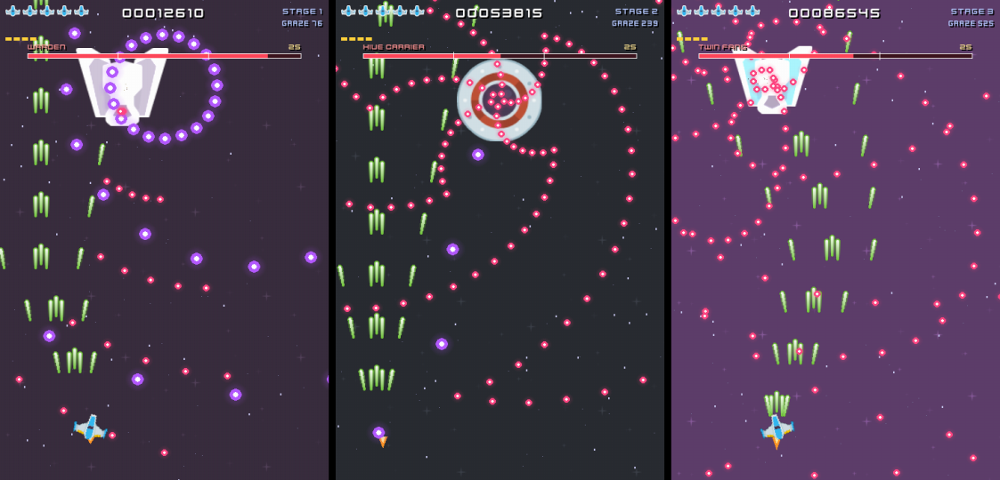

# Vertical Shmup

縱向彈幕射擊遊戲（bullet-hell shmup），附帶一個用 **Deep Q-Network** 訓練的自動駕駛 agent，
會自己閃避敵人和子彈、吃道具。有 **pygame 版**和**網頁版**（給 demo 用，免安裝）。

> 所有素材、演算法、函式庫都是 **2019 年以前**就有的，見下方「2019 年前規範」。


## 快速開始

```bash
pip install -e ".[game]"       # 玩遊戲：numpy + pygame
pip install -e ".[game,rl]"    # 再加 PyTorch：自動駕駛 / 訓練
```

訓練完全不需要畫面：`core/` 和 `agent/` 不會 import pygame，Colab 上連 pip install 都不用。

```bash
python -m shmup                 # 自己玩
python -m shmup --autopilot     # 看 DQN 自己玩（需要先訓練）
```

| 按鍵 | 功能 |
|------|------|
| 方向鍵 / WASD | 移動 |
| Shift | 慢速精準移動（focus，會顯示判定點） |
| X | 炸彈 |
| Tab | 自動駕駛開 / 關 |
| V | Agent 視角（顯示網路看到的危險格） |
| P / M / Esc | 暫停 / 靜音 / 離開 |

## 遊戲設計

參考經典彈幕射擊（東方、怒首領蜂這一類遊戲）的**玩法類型**，全部重新實作：

- **敵人會開火**：自機狙（瞄準你）、扇形彈、環形彈、旋轉螺旋彈、雷射
- **敵人種類**：Scout（直線 + 自機狙）、Weaver（蛇行 + 三向扇形）、Diver（停頓後鎖定衝撞）、
  Gunship（停留發射環形彈 + 雷射）、隕石（打碎會分裂）、**Boss**（3 個階段，每階段彈幕不同）
- **道具**：火力升級（最多 4 級）、回血、護盾（擋一次）、炸彈、加分星星
- **彈幕類經典機制**：
  - 極小判定點（5 px），擦彈（graze）加分
  - 炸彈清除全畫面子彈；被打中時若還有炸彈會**自動放炸彈**抵銷
  - 被打後有無敵時間、火力降一級
  - 飛到畫面上方「收點線」時，所有道具自動吸過來
- **魔王關卡**：每關的節奏是

  ```
  雜魚波次 → 中魔王 SENTINEL（25 秒）→ 雜魚波次 → WARNING → 關卡魔王（3 階段）→ 下一關
  ```

  | 關卡 | 魔王 | 階段 1 | 階段 2 | 階段 3 |
  |------|------|--------|--------|--------|
  | 1, 4, 7… | WARDEN | Aimed Fans | Twin Spiral | Last Stand |
  | 2, 5, 8… | HIVE CARRIER | Drone Bay（放出無人機） | Bloom（反轉花形彈） | Laser Rain |
  | 3, 6, 9… | TWIN FANG | Crossfire | Pinwheel | Fang Rush（追著玩家） |

  HP 到 66% / 33% 換階段並清空子彈；每階段 30 秒時限，時限內打破有加分，
  最後階段時間到魔王會逃走。每輪一次魔王，HP 與彈幕速度都會提升。

  

## 專案結構

```
vertical-shmup/
├── pyproject.toml          套件設定與相依套件（取代 requirements.txt）
├── README.md / CREDITS.md
├── assets/                 所有素材（pygame 和網頁版共用）
│   ├── images/{player,enemies,projectiles,items,effects,backgrounds,ui}/
│   ├── sounds/{sfx,music}/
│   ├── fonts/
│   └── licenses/           素材原始授權檔
├── src/shmup/              Python 套件（src layout）
│   ├── __main__.py         `python -m shmup` 進入點
│   ├── paths.py            所有路徑集中管理
│   ├── core/               純遊戲邏輯，不 import pygame，可無畫面高速執行
│   │   ├── rules.py        所有可調數值（唯一來源，會匯出給網頁版）
│   │   ├── rng.py          可重現的亂數（xorshift32，JS 版逐位元相同）
│   │   ├── entities.py     玩家、子彈、道具
│   │   ├── enemies.py      敵人與 Boss 行為
│   │   ├── patterns.py     彈幕發射樣式（自機狙 / 扇形 / 環形）
│   │   ├── director.py     出怪波次與 Boss 排程
│   │   └── world.py        World：一個 frame 的完整更新與碰撞
│   ├── client/             pygame 前端（只負責畫面、輸入、音效）
│   │   ├── app.py  renderer.py  effects.py  assets.py  audio.py
│   └── agent/              強化學習
│       ├── features.py     World → 284 維觀測向量；18 個動作
│       ├── env.py          Gym 風格環境 + 多程序向量環境
│       ├── dqn.py          網路、Replay Buffer、n-step、Double DQN loss
│       ├── trainer.py      訓練迴圈、評估、checkpoint
│       ├── policy.py       推論（給 pygame 自動駕駛用）
│       └── export.py       匯出規則與權重給網頁版
├── scripts/                可直接執行的指令
│   ├── train_cpu.py        CPU 版訓練
│   ├── train_gpu.py        GPU（CUDA）版訓練
│   └── export_web.py       匯出模型到 web/
├── web/                    網頁版（純 HTML5 Canvas + JavaScript，無任何框架）
│   ├── index.html  css/style.css
│   ├── js/                 rules.js(自動產生) rng core features policy renderer audio main
│   └── model/              dqn_model.js（由 export_web.py 產生）
├── notebooks/              train_on_colab.ipynb（Google Colab 訓練用）
├── models/                 訓練出的 checkpoint（不進 git）
├── tests/                  pytest 測試，包含 Python ↔ JavaScript 一致性測試
└── docs/                   README 圖片
```

### 這樣命名 / 分層的原因（專業寫法重點）

- **src layout**：程式放在 `src/shmup/`，避免「在專案根目錄剛好 import 得到」的假象，
  安裝後的行為和開發時一致。
- **依責任分層**：`core`（規則，無副作用）→ `client`（畫面）/ `agent`（AI）。
  `core` 不依賴 pygame，所以訓練時能無畫面跑到每秒上萬 frame，網頁版也能逐行移植。
- **檔名用 snake_case、表達「是什麼」**：`world.py`、`director.py`、`trainer.py`，
  不用 `main2.py`、`game_new.py` 這種名字；類別用 PascalCase（`World`、`DuelingQNetwork`），
  常數用 UPPER_CASE 並集中在 `rules.py`。
- **單一來源（single source of truth）**：數值只寫在 `rules.py`，網頁版的 `rules.js` 由腳本產生，
  測試會檢查它沒有過期。
- **素材用語意化資料夾與檔名**：`enemies/scout.png` 而不是 `enemyGreen1.png`。
- **可重現**：自訂 xorshift 亂數，同一個 seed 在 Python 和瀏覽器跑出完全一樣的遊戲。
- **入口集中**：`python -m shmup`、`scripts/*.py`，每個腳本開頭的 docstring 就是使用說明（`--help`）。

## 自動駕駛 Agent（只用 2019 年前的方法）

| 技術 | 出處 |
|------|------|
| Deep Q-Network、Experience Replay、Target Network | Mnih et al., *Nature* 2015 |
| Double DQN | van Hasselt et al., AAAI 2016 |
| Dueling Network | Wang et al., ICML 2016 |
| n-step return（n=3） | Sutton 1988；Rainbow 2017 |
| Adam、Huber loss、ε-greedy、梯度裁剪 | 2014 及更早 |

- **觀測**（284 維，不是像素，所以小 MLP 就學得動，瀏覽器也跑得動）：
  自機狀態、最近 24 顆子彈（相對位置 + 速度）、最近 8 個敵人、
  **9×9 危險格**（預測 0/6/12/18 frame 後子彈會在哪）、最近 2 個道具、Boss 狀態。
- **動作**（18 個）：9 個方向 × {一般速度, 慢速}，每 2 frame 決定一次（30 次 / 秒）；自動射擊。
- **獎勵**：每步存活 +0.01、掉血 -1、被迫自動炸彈 -0.5、護盾破 -0.3、吃道具 +0.05、
  分數 ×0.0002、死亡 -1。

### 訓練

```bash
python scripts/train_cpu.py                      # CPU：8 局並行、256 單元、300 萬步
python scripts/train_cpu.py --total-steps 500000 # 快速試跑
python scripts/train_gpu.py                      # GPU：64 局多程序並行、512 單元、batch 512
python scripts/train_cpu.py --eval-only          # 評估 models/dqn.pt
python scripts/train_cpu.py --help               # 所有超參數都可以用參數改
```

最佳模型存到 `models/dqn.pt`，最新的（含 optimizer，可續訓）存到 `models/dqn_last.pt`
（Ctrl+C 中斷也會存），用 `--resume models/dqn_last.pt` 接著訓練。
GPU 版只用 PyTorch 1.0 時代就有的 CUDA 功能（無 AMP / MPS），**Mac 沒有 CUDA，請用 CPU 版**。

### 在 Google Colab 上訓練

1. 本機打包：`git archive --format=zip --prefix=vertical-shmup/ -o ~/Desktop/vertical-shmup.zip HEAD`，
   把 zip 上傳到 Google Drive 根目錄。
2. 在 Colab 上傳 `notebooks/train_on_colab.ipynb`，執行階段選 **T4 GPU**，依序執行每個 cell。
   checkpoint 和 log 會存到 `MyDrive/shmup/`，斷線後用 `--resume` 續訓。
3. 下載 `dqn.pt` 放到 `models/`、`dqn_model.js` 放到 `web/model/`，在本機 demo。

## 網頁版（Demo 用）

```bash
python scripts/export_web.py        # 把 models/dqn.pt 轉成 web/model/dqn_model.js
```

然後直接用瀏覽器打開 `web/index.html`；或在專案根目錄開一個本機伺服器（字型和音效載入較完整）：

```bash
python -m http.server 8000
```

再開 <http://localhost:8000/web/>。右側面板可以切換自己玩 / 自動駕駛、Agent 視角、
1× / 2× / 4× 速度、**Jump to boss / Next stage boss**（直接跳到魔王戰），
並即時顯示 18 個動作的 Q 值與自動駕駛的平均分數。
網頁版的神經網路推論是手寫的 JavaScript 矩陣乘法，不需要任何 ML 函式庫。
（Safari 不支援 .ogg 音效，建議用 Chrome / Firefox。）

## 測試

```bash
pip install -e ".[rl,dev]"
pytest
```

`tests/test_web_parity.py` 會用同一個 seed 分別跑 Python 和 Node.js 版 30,000 frame（包含三種魔王），
確認分數、子彈數、亂數狀態、觀測向量完全一致，並確認匯出的網路在 JS 中算出的 Q 值和 PyTorch 相同；
沒有安裝 Node.js 時會自動跳過。

## 2019 年前規範

- **素材**：Kenney Space Shooter Redux（2014）、Digital Audio（2012）、Music Jingles（2014），
  OpenGameArt 上 Matthew Pablo 的 *Orbital Colossus*（2013）。壓縮檔內的檔案日期也都在 2019 年前。
  詳見 [CREDITS.md](CREDITS.md)。
- **演算法**：見上表，最新的是 2017 年。
- **函式庫**：pygame（2000）、NumPy（2006）、PyTorch（2016），程式只用 PyTorch 1.0（2018）就有的 API；
  NumPy 只用舊式 `RandomState`。網頁版只用 HTML5 Canvas 與 ES5/ES2015 語法，沒有任何外部函式庫。
  （在新版 Python 上要用新版 pygame / PyTorch 安裝，但用到的功能在 2019 年前都已存在。）
